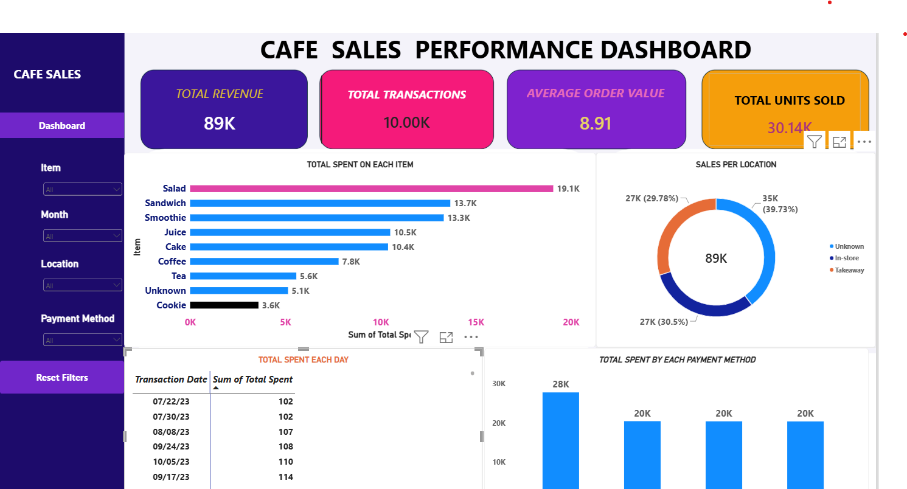

# Café Sales Data Analysis

Sales performance, data quality, SQL analysis, and Power BI dashboard review

**Prepared by:** Chukwuma Kanayochukwu James  
**Date:** November 25, 2026

## Table of Contents

1. [Executive Summary](#executive-summary)
2. [Project Overview](#project-overview)
3. [Dataset](#dataset)
4. [Dashboard](#dashboard)
5. [Key Findings](#key-findings)
   - [Product Performance](#product-performance)
   - [Monthly Revenue](#monthly-revenue)
   - [Weekday Revenue](#weekday-revenue)
   - [Service Location](#service-location)
   - [Payment Method](#payment-method)
6. [Recommendations](#recommendations)
7. [Limitations](#limitations)
8. [SQL Analysis](#sql-analysis)
9. [Power BI Measures](#power-bi-measures)
10. [Conclusion](#conclusion)

    
    
## Executive Summary

This analysis reviews 10,000 café transaction records from 2023. The dataset contains 10,000 unique transaction IDs. Recorded sales total **$88,952 across 9,960 transactions with usable totals**, for an average transaction value of **$8.93**.

- **Salad** generated the most revenue (**$19,070**), while **Coffee** sold the most known units (**3,902**).
- Among records with valid dates and totals, **June** had the highest monthly revenue (**$7,350**) and **Thursday** had the highest weekday revenue (**$12,394**).
- Data quality issues include 40 unusable totals, 38 unusable quantities, 38 unusable unit prices, 460 unusable dates, 480 Unknown item labels, 3,961 Unknown location labels, and 3,178 Unknown payment labels.

Monthly and weekday rankings describe this single year only; they do not establish recurring seasonality or customer behavior.

## Project Overview

The goal was to understand sales patterns, identify performance drivers, and provide practical recommendations for café operations. The project used:

- **Microsoft Excel** for data inspection, cleaning, formatting, and derived date fields
- **SQL Server Management Studio (SSMS)** for structured queries and aggregation
- **Power BI** for a one-page interactive dashboard with measures, KPI cards, charts, and slicers
- **PowerPoint and Word** for an executive presentation and written report

## Dataset

The source file, `Cafe-sales.csv`, contains 10,000 rows and 10 columns covering January–December 2023.

| Field | Type | Description |
|---|---|---|
| Transaction ID | Text | Unique transaction identifier |
| Item | Text | Product purchased |
| Quantity | Integer | Number of units purchased |
| Price Per Unit | Numeric | Price of one unit |
| Total Spent | Numeric | Recorded transaction amount |
| Payment Method | Text | Payment method used |
| Location | Text | In-store or takeaway channel |
| Transaction Date | Date | Date of purchase |
| Month | Text | Month of transaction |
| Day of Week | Text | Weekday of transaction |

The source contains errors, Unknown labels, and missing values. Data cleaning was performed in Excel before SQL analysis. For time-based analysis, Month and Day of Week should be derived from the transaction date.

## Dashboard

## Key Findings

### Product performance

Salad generated the highest item revenue at **$19,070** from 1,269 transactions with valid totals. Coffee had the highest known unit sales at **3,902**. Cookie had the lowest revenue among named products at **$3,589**. Unknown items accounted for another **$5,141** across 477 valid-total transactions.

| Item | Valid-total transactions | Revenue | Known units |
|---|---:|---:|---:|
| Salad | 1,269 | $19,070 | 3,818 |
| Sandwich | 1,123 | $13,664 | 3,424 |
| Smoothie | 1,091 | $13,320 | 3,330 |
| Juice | 1,167 | $10,509 | 3,505 |
| Cake | 1,137 | $10,395 | 3,462 |
| Coffee | 1,285 | $7,798 | 3,902 |
| Tea | 1,203 | $5,466 | 3,635 |
| Unknown | 477 | $5,141 | 1,471 |
| Cookie | 1,208 | $3,589 | 3,594 |
| **Total** | **9,960** | **$88,952** | **30,141** |

### Monthly revenue

Of 9,501 transactions with both a valid total and date, June led with **$7,350** and February was lowest at **$6,633.50**. The difference was **$716.50 (10.8% of February revenue)**. This is a one-year comparison, not evidence of a recurring seasonal pattern.

| Month | Valid transactions | Revenue |
|---|---:|---:|
| January | 814 | $7,242 |
| February | 724 | $6,633.50 |
| March | 825 | $7,214.50 |
| April | 769 | $7,168 |
| May | 771 | $6,941.50 |
| June | 816 | $7,350 |
| July | 789 | $6,877.50 |
| August | 800 | $7,077.50 |
| September | 784 | $6,846 |
| October | 836 | $7,302 |
| November | 782 | $6,957 |
| December | 791 | $7,177 |
| **Total with valid date** | **9,501** | **$84,786.50** |

### Weekday revenue

Thursday led with **$12,394**, while Wednesday was lowest at **$11,616.50**. The weekday analysis covers $84,786.50 across 9,501 valid dated transactions.

| Weekday | Valid transactions | Revenue |
|---|---:|---:|
| Monday | 1,377 | $12,135 |
| Tuesday | 1,307 | $12,030.50 |
| Wednesday | 1,333 | $11,616.50 |
| Thursday | 1,374 | $12,394 |
| Friday | 1,381 | $12,317.50 |
| Saturday | 1,352 | $12,007.50 |
| Sunday | 1,377 | $12,285.50 |
| **Total with valid date** | **9,501** | **$84,786.50** |

### Service location

Among known locations, In-store revenue was **$27,127** and Takeaway revenue was **$26,487.50**, a difference of $639.50 (about 2.4% of Takeaway revenue). Unknown location labels represent a substantial portion of sales, limiting the known-channel comparison.

| Location | Valid-total transactions | Revenue |
|---|---:|---:|
| In-store | 3,003 | $27,127 |
| Takeaway | 3,009 | $26,487.50 |
| Unknown | 3,948 | $35,337.50 |

### Payment method

Revenue among named payment methods was close. Cash had the highest average transaction value among named methods at **$9.06**. Unknown labels account for $27,775 across 3,164 valid-total transactions. These small differences do not establish customer preference or payment profitability.

| Payment method | Valid-total transactions | Revenue | Average transaction |
|---|---:|---:|---:|
| Credit Card | 2,266 | $20,427 | $9.02 |
| Digital Wallet | 2,282 | $20,383.50 | $8.93 |
| Cash | 2,248 | $20,366.50 | $9.06 |
| Unknown | 3,164 | $27,775 | $8.78 |

## Recommendations

1. **Promote strong products.** Test promotions, bundles, and recommendations featuring high-revenue products such as Salad, while monitoring both revenue and units sold.
2. **Prepare for busier weekdays.** Review staffing, service flow, and stock availability for Thursday and other high-revenue days.
3. **Investigate monthly differences.** Examine what contributed to June's results before applying those practices to weaker months; use further years of data to validate any seasonal pattern.
4. **Improve data collection.** Reduce missing and Unknown item, location, payment, date, quantity, price, and total values so comparisons cover more transactions.
5. **Align inventory to demand.** Prioritize fast-selling products while managing waste and stockout risk for lower-volume products.
6. **Review pricing and promotions.** Evaluate bundles and discounts with transaction-level results before adopting them broadly.
7. **Improve the customer experience.** Maintain product availability, efficient service, and convenient payment options.

## Limitations

- Unknown item, location, and payment labels make named-category comparisons incomplete. Unknown values should not be silently reassigned or removed.
- The dataset has no product costs, labor costs, customer IDs, discounts, promotion calendar, or transaction times. Profit, retention, promotion effects, hourly staffing demand, and causal effects cannot be calculated.
- Only 2023 is available, so year-over-year trends and recurring seasonality cannot be established.
- Recommendations are framed for café operations and may need adjustment for another audience.

